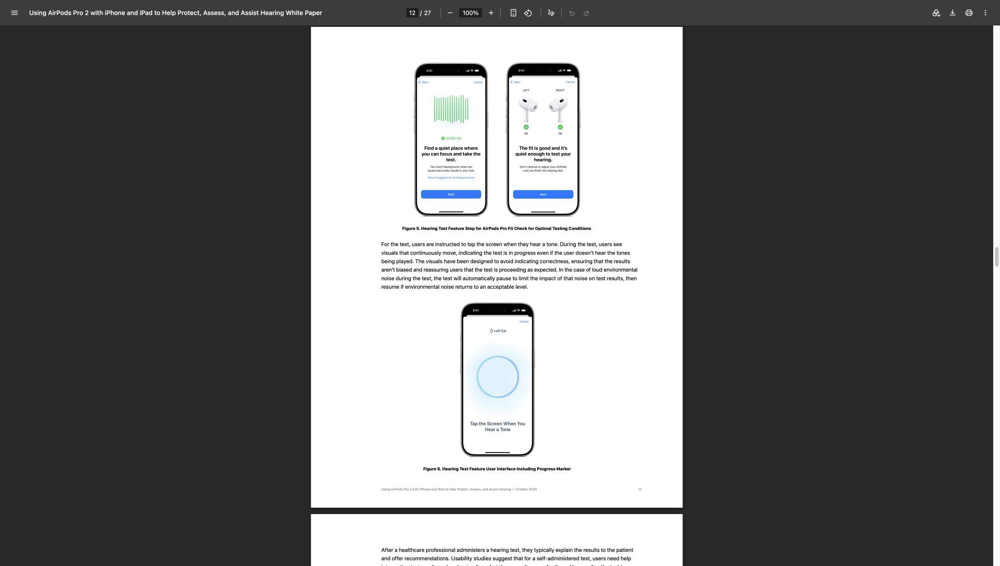
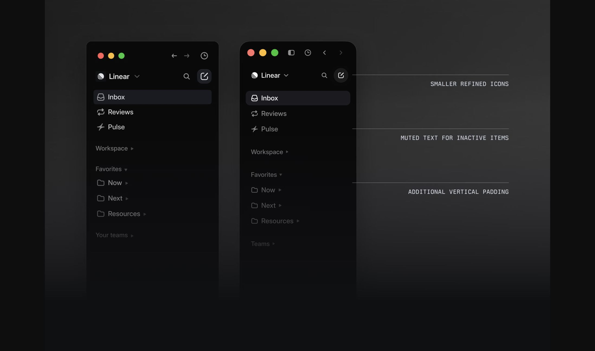
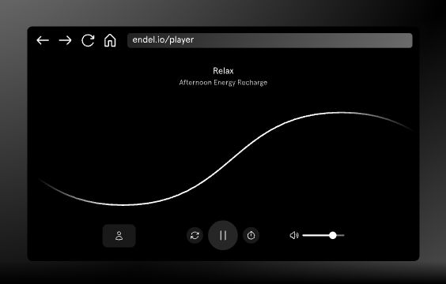

# Onboarding visual references

These references inform spacing, hierarchy, and playback controls within Dit's design direction. Screenshots are reference material only; none are app assets. Apply the product fidelity gate in `DESIGN.md` to every adaptation.

## Apple: audio setup

[Source: Apple's hearing-health white paper, page 12](https://www.apple.com/health/pdf/Hearing_Health_Features_on_AirPods_Pro_2_October_2024.pdf#page=12)

Observed: a substantial illustration above the instruction, quiet navigation, and a bottom action at the same position across the two setup screens. Green checkmarks confirm a completed check.

Apply to Dit: keep the shared intro illustration stage and anchored footer. Use a small green check only after the learner confirms hearing the sound. Medical testing, wave graphics, and device checks are not part of Dit's flow.

## Linear: visual hierarchy

[Source: A calmer interface for a product in motion](https://linear.app/now/behind-the-latest-design-refresh)

Observed: inactive items recede, selected content remains legible, and spacing separates groups without outlining every item.

Apply to Dit: retain quiet Back and progress controls; keep confirmation choices unboxed. Match heading weights across setup and intro screens so the flow feels like one interface.

## Endel: recognizable playback

[Source: Endel's web-player screenshot](https://endel.io/pages/index/endel-desktop/endel-for-web.svg), linked from [Endel](https://endel.io/).

Observed: a circular playback control is identifiable by its transport icon, with supporting controls visually subordinate.

Apply to Dit: add a play icon to the sound-check control while retaining its text label. Keep Dit's liquid background and palette. Endel's waveform is not a model for illustrating Morse characters.

## Applied values

These are Dit implementation choices, not measurements inferred from reference screenshots:

- Existing system font; screen headings 28–36px, weight 600.
- Existing palette: backdrop `hsl(207, 40%, 4%)`, text `hsl(24, 29%, 97%)`, accent `hsl(24, 100%, 65%)`, confirmed check `hsl(154, 88%, 58%)`.
- Sound-check circle remains 152px, or 112px on short viewports. Play icon 32px; icon-to-label gap 12px.
- Confirmation check 18px, with space reserved before it appears. Button hit height remains at least 44px.
- Exercise content stays within 640px, with a scrollable middle and 48px footer. Updated October 4: desktop navigation spans the viewport at 900px and above, using 32–64px edge insets with Continue centered at the bottom; mobile keeps its compact frame.

Verification: review idle, played, confirmed, and no-sound states at desktop and phone widths. Preserve button positions and test real audio output separately from appearance.
